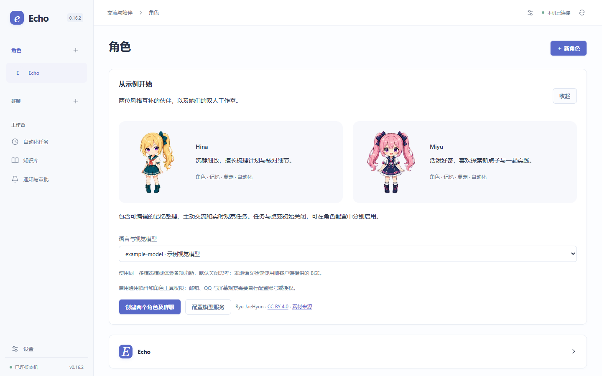

<p align="center">
  
</p>

<h1 align="center">Echo Agent</h1>

<p align="center"><strong>面向长期协作的个人 Agent 工作台</strong></p>

<p align="center">
  在 Windows 上创建有记忆的 AI 角色，在会话里交办工作，也让角色按你的规则主动跟进。
</p>

<p align="center">
  <a href="https://github.com/Kzkz233/echo-agent/releases/latest"></a>
  <a href="https://github.com/Kzkz233/echo-agent/releases/latest"></a>
  <a href="LICENSE"></a>
</p>

<p align="center">
  <a href="https://github.com/Kzkz233/echo-agent/releases/latest"><strong>下载 Windows 安装包</strong></a>
  &nbsp;·&nbsp;
  <a href="#快速开始">快速开始</a>
  &nbsp;·&nbsp;
  <a href="#项目文档">项目文档</a>
  &nbsp;·&nbsp;
  <a href="https://github.com/Kzkz233/echo-agent/issues">问题反馈</a>
</p>

<p align="center">
  
  <br>
  <sub>从示例角色 Hina 与 Miyu 开始，体验角色会话、群聊、桌宠和自动化。</sub>
</p>

## 快速开始

1. **安装 Echo Agent。** 从 [最新发布](https://github.com/Kzkz233/echo-agent/releases/latest) 下载以 `_x64-setup.exe` 结尾的安装程序。安装程序可补齐缺失的 WebView2。
2. **连接模型。** 打开 **设置 → 模型服务**，添加在线 API 或本地模型服务。测试连接后，选择模型并保存。
3. **开始对话。** 新建角色、导入角色包，或在角色页面选择 **从示例开始**，创建 Hina、Miyu 和她们的双人工作室。示例需要同时支持语言与视觉的模型。桌宠与自动化任务可在角色配置中分别启用。

## 主要功能

每个角色有独立的会话、记忆、授权和任务。Echo Agent 内置会话与工具执行能力，语言模型由你选择。工作可以留在同一个角色里持续跟进，自动化任务的输出可以按任务送到主会话、通知、桌宠气泡或已绑定的 QQ。

| 功能                   | 可以做什么                                                                                                                                      |
| ---------------------- | ----------------------------------------------------------------------------------------------------------------------------------------------- |
| **角色与会话**         | 编辑人设，导入或导出角色包，与单个角色对话或邀请多个角色参加群聊。                                                                              |
| **工具与子任务**       | 给角色授权工作目录和工具，让它自行处理任务或委派子任务。在角色工作台查看进度、结果和历史。可通过插件接入 Codex 或 DeepSeek Harness 执行子任务。 |
| **记忆与知识库**       | 按时间或对话轮数整理角色记忆。个人知识库支持文档解析、原件与版本管理，以及关键词、语义和混合检索。安装包附带可离线使用的 BGE 中文向量模型。     |
| **主动交流与屏幕观察** | 设置角色主动交流的频率和避让条件，或允许角色观察指定网站和应用。白名单与画面裁切在本机处理，观察模型和输出位置按任务配置。                      |
| **桌宠与消息渠道**     | 多个角色可以同时显示为桌宠，从气泡直接回复角色。也可启用 QQ 插件，让绑定的聊天进入同一角色会话。                                                |
| **日程、邮件与扩展**   | 按需启用日历和邮箱提醒。插件可以注册工具、自动化任务类型、消息输出和工作台入口。                                             |

## 数据与权限

- 角色、会话、记忆和知识默认存放在本机。Windows 凭据使用系统保护机制保存。使用在线服务时，Echo Agent 会把请求所需的数据发给所选服务。
- 屏幕观察默认关闭。启用后，只处理白名单内的可见内容，截图默认不保存。
- 工作目录和工具权限按角色授权。核心记忆变更、邮件发送和远端邮件整理需要审批。停用角色会停止其会话、自动化任务、渠道收发和桌宠，配置与历史保留。

## 项目文档

| 主题           | 文档                                                                                                                |
| -------------- | ------------------------------------------------------------------------------------------------------------------- |
| 角色配置与使用 | [角色与群聊](docs/CHARACTERS.md) · [桌宠](docs/AVATAR.md) · [消息渠道](docs/CHANNELS.md)                            |
| 模型与任务     | [模型服务](docs/INFERENCE.md) · [子任务执行器](docs/BACKENDS.md) · [任务与自动化](docs/TASKS-AND-ACTIVITY.md)       |
| 数据与检索     | [检索与知识存储](docs/RETRIEVAL-AND-STORAGE.md) · [数据目录与备份](docs/STORAGE.md) · [隐私与恢复](docs/PRIVACY.md) |
| 架构与扩展     | [应用架构](docs/ARCHITECTURE.md) · [插件开发](docs/PLUGINS.md) · [安全报告](SECURITY.md)                            |

## 命令行

安装包自带命令行工具，可以诊断后台、查看任务、手动运行整理并在终端发送消息。详见 [命令行指南](docs/CLI.md)。

## 开发与贡献

需要 Node.js 24+ 和 pnpm。构建 Windows 桌面版还需要 Rust、MSVC 和 WebView2。

```powershell
pnpm install --frozen-lockfile
pnpm verify
pnpm desktop:build
```

详见 [贡献指南](CONTRIBUTING.md)。

## 许可证

项目原创代码采用 [Apache-2.0](LICENSE)。Hina 与 Miyu 的示例动画由 Ryu JaeHyun 创作，按 CC BY 4.0 使用。素材来源与第三方组件许可见 [第三方声明](THIRD_PARTY_NOTICES.md)。
