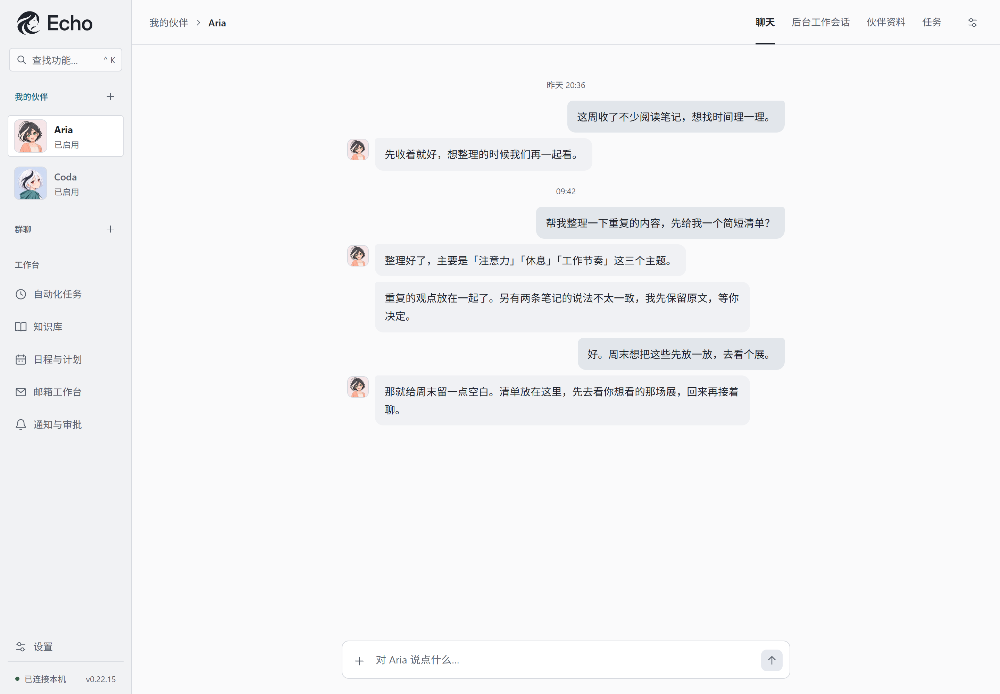

  

<h1 align="center">Echo Agent</h1>

有记忆、能协作的桌面 AI 伙伴。

  <a href="https://github.com/Kzkz233/echo-agent/releases/latest">下载 Windows 版</a> ·
  <a href="docs/GETTING-STARTED.md">快速开始</a> ·
  <a href="docs/README.md">文档</a> ·
  <a href="https://github.com/Kzkz233/echo-agent/releases">更新日志</a>

  
  

<picture>
  <source media="(prefers-color-scheme: dark)" srcset="docs/screenshots/chat-dark.png">
  
</picture>

Echo 是开源的 Windows 个人 Agent 应用。你可以创建有独立人设与记忆的角色，在聊天中交办工作，让角色通过工具、子任务和自动化持续跟进。模型服务由你选择，角色与资料保存在本机，功能通过插件扩展。

## 核心能力

- **持续对话** — 应用聊天、QQ 和桌宠气泡接入同一个角色工作会话，各渠道可设置独立表达风格。
- **记忆与知识** — 整理角色记忆，归档文档和音视频，使用全文、语义或混合检索查找资料。
- **任务执行** — 为角色配置工具与工作目录，委派 Pi、Codex 或 DeepSeek Harness 子任务，查看执行过程、审批和结果。
- **主动陪伴** — 配置主动交流与屏幕观察，通过桌宠和消息渠道接收反馈。
- **可扩展架构** — 安装独立插件，连接外部 MCP 服务，扩展工具、页面、渠道和自动化任务。

## 安装与开始

1. 下载最新 Release 中的 **Windows x64 安装程序**，文件名以 `_x64-setup.exe` 结尾。
2. 在 **设置 → 模型服务** 添加模型连接，填写服务地址和凭据，选择可用模型。
3. 创建角色或选择 **从示例开始**，指定语言模型后进入聊天。

安装程序会检测 WebView2，缺失时引导安装。示例角色附带桌宠素材，屏幕观察需要另行配置视觉模型和允许观察的内容。

[安装与首次配置](docs/GETTING-STARTED.md) · [更新与恢复](docs/UPDATES.md)

## 文档

| 使用 Echo | 开发与扩展 |
| --- | --- |
| [角色、记忆与群聊](docs/CHARACTERS.md) | [应用架构](docs/ARCHITECTURE.md) |
| [任务与自动化](docs/FEATURES.md#任务与自动化) | [插件开发](docs/PLUGINS.md) |
| [知识库与音视频](docs/FEATURES.md#知识库与音视频) | [独立扩展](docs/independent-extensions.md) |
| [模型服务](docs/INFERENCE.md) | [界面与主题](docs/DESIGN-SYSTEM.md) |
| [命令行](docs/CLI.md) | [贡献指南](CONTRIBUTING.md) |

[浏览全部文档](docs/README.md)

## 数据与权限

角色、会话和知识库默认存放在本机。连接在线模型、文档解析或消息服务后，请求所需内容会发送给相应服务。工具和工作目录按角色授权，屏幕观察默认关闭，核心记忆变更需要审批。

[数据存储](docs/STORAGE.md) · [隐私说明](docs/PRIVACY.md) · [安全说明](SECURITY.md)

## 参与项目

欢迎提交问题、文档改进和代码贡献。报告问题时，请附版本、复现步骤及经过脱敏的日志。开发环境和验证方法见贡献指南。

[问题反馈](https://github.com/Kzkz233/echo-agent/issues) · [贡献指南](CONTRIBUTING.md)

## 许可证

原创代码采用 [Apache-2.0](LICENSE)。示例角色动画由 Ryu JaeHyun 创作，按 CC BY 4.0 使用。素材来源与依赖许可见 [第三方声明](THIRD_PARTY_NOTICES.md)。
