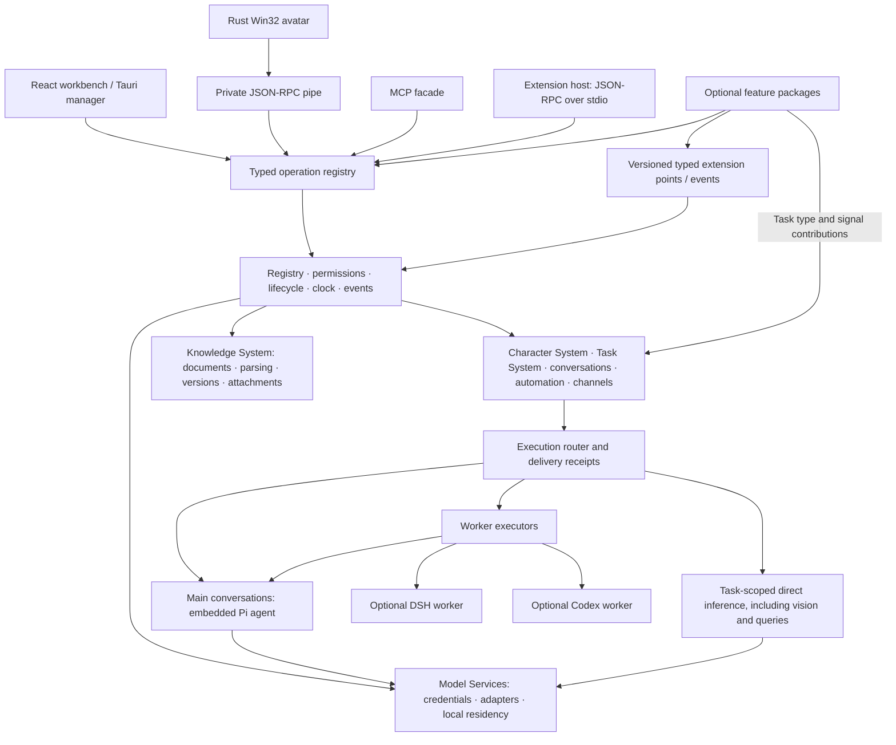

# Architecture

Echo is a new application, not a collection of separately deployed Workspace services. No old-interface compatibility layer is included.

## Layers



Node/TypeScript owns application state; React/Vite is the default-light management UI. Rust owns the Tauri tray/manager, native Win32 avatar/bubble/reply controls and Windows capture helper. Avatar animation does not create a WebView. Runtime SQLite is separate from each registered library's SQLite Markdown/metadata container and content-addressed media objects. Optional parsing, export, backup and local embeddings use on-demand Workers. No Python environment is required.

## Minimal core

As of 0.14, the visible fixed components are Storage, Clock, Model Services,
Character System, Task System and Knowledge System. Existing implementation IDs
such as `files`, `documents`, `assets`, `embeddings` and `local-models` are internal
adapters, not separately toggled product features. Their bounded execution and
shutdown hooks remain part of the application lifecycle. Registering a local
runtime does not download or load a model.

Knowledge System owns the shared document type: one original per document,
content-addressed objects, Markdown body, metadata, versions, parsing and reading.
Personal Knowledge is the default user-editable collection. Character profiles,
memories, concerns and run archives form a character-facing library, with separate
producer-specific storage and mutation policies behind that logical view. This
is a logical consolidation, not a destructive rewrite of existing library files.
Core memory approval remains mandatory.
Normal personal-library navigation excludes these managed collections; advanced
browsing is read-only unless a collection explicitly grants user editing.

Model selection uses eligibility projected by the backend: supported task IDs,
main-conversation eligibility and worker eligibility. Projection, route saving and
execution share one policy over the model declaration, active adapter and task
requirements. Frontend widgets only narrow this set for display. A plugin model
field can declare `inferenceTask`; it then receives exactly that task's available
models. Missing tasks and adapters expose no valid choices, while existing values
remain visible as unavailable. Inherited choices resolve against the role's
current route/main binding (or the unsaved role draft) before selection.

`knowledge.queries@1` and `knowledge.retrieval@1` own reusable query construction
and retrieval contracts. Local bounded keyword extraction and BM25 require no
model. Memory supplies authorized records and may contribute a role-specific
model query builder. Semantic Search contributes semantic/hybrid strategies,
query expansion and reranking; it never depends on Memory. Model categories are
registered by Semantic Search, while encoding and process supervision belong to
Model Services. Existing route and provider IDs remain valid.

Manifest relationships use `dependencies` and `optionalDependencies`. Both are
directed from consumer to provider and participate in DAG validation. Requested
optional providers load first; disabling one removes its contributions without
disabling the consumer. `enhances` is accepted only as legacy input and normalized
to optional dependencies. Built-in implementation dependencies are omitted from
the ordinary plugin relationship display.

Calendar owns `agenda.fields@1` (editor fields and validation) and
`agenda.reschedule@1` (provider-owned derived metadata). Calendar dragging uses revision-checked, idempotent rescheduling and undo. Imported
records are insert-only, retain provenance and never replay historical reminders.
Windows workbench windows disable Tauri's native file-drop interception so DOM
dragging reaches the calendar. Native acceptance uses the operating system
pointer against an isolated executable, rather than relying only on Chromium's
synthetic drag protocol. Child drag events do not bubble into parent tasks;
independently dated children retain their relationship and appear on their own date.

Portraits are optional character data, independent of desktop-pet assets. Local
input is decoded and normalized to a 256-pixel WebP; the bounded image travels
inside the character package. Portrait data is never included in persona text or
model prompts. The workbench shares one rendering component across character and
conversation navigation.

The technical kernel owns registration, schemas, permissions, lifecycle, versioned extension points, events, storage and the nearest-deadline clock. Fixed application components use the same registration lifecycle, but have no install or disable switch. Users can pause individual tasks and bindings. With feature plugins disabled, Personal Knowledge and role management remain available; there is no capture helper, loaded model worker, model call or scheduled feature task. The clock has no timer when no alarm is registered. Pi is loaded on first use.

Required plugin dependencies form a DAG. Each arrow points from consumer to required provider; built-in implementation adapters are omitted:

```text
Memory → Character System + Knowledge System
Review → Memory
Semantic Search → Knowledge System + Model Services
Mail Actions → Mail + Approvals
```

Review consumes optional material providers. Observation registers a provider while enabled; removing it does not disable ordinary conversation Review. Persona and recall register context providers. Avatar consumes events and delivery receipts without becoming an inference backend.

The arrows describe activation requirements, not every collaboration. Optional contributions form a runtime graph without hard dependencies: Mail and Agenda contribute selectable Review materials; Observation can block Care; business plugins contribute Scheduler handlers. Mail and Agenda own structured records and do not depend on Knowledge or vector search. Removing a provider removes that choice. Frozen Review packets remain self-contained.

Core exposes `core.automation.types@1`. Plugins contribute a task descriptor, editable fields, saved instances and supported actions. The workbench renders these tasks together. A type can link to a dedicated editor when it has richer controls. Each plugin owns persistence, run eligibility and recovery for its own tasks. Each Review task owns its incremental progress. Each character's Review task selects conversations, material providers, targets, prompts and report destination independently.

Core also exposes `core.automation.signals@2`. Observe, Care and Email Triggers register their own signal types and apply their own task policies before requesting a conversation run or a deterministic notice. The common entry point checks source ownership, allowed actions, cancellation, expiry and conversation availability. A waiting human message takes priority over a new background run. Human inputs use the same conversation router and receipts through their own queue. Read operations continue to return results directly. Task providers do not have to translate queries or internal work into trigger signals.

## Plugin packages and extension contracts

Every bundled feature has `plugins/<id>/echo-plugin.json`, a canonical English name, an `@echo/<id>` package label, API version, dependencies, permissions, settings and optional view IDs. The same manifest schema validates bundled and local process packages. The `@echo` labels do not imply npm publication; local code cannot gain first-party identity by claiming that prefix.

The extension host knows no Review, mail or retrieval logic. A plugin may define any namespaced `plugin.topic@version` extension point with input/output schemas and separate provider/consumer permissions. Other plugins register their namespaced offerings. Examples: `review.materials@1`, `files.extract@1`, `core.retrieval@1`, `scheduler.handlers@1`, `care.blockers@1`, `notifications.channels@1`.

One mechanism hosts different contracts. Review sources return attributed text records; retrieval providers return IDs, versions and scores within the supplied candidate scope; parsers return extracted text or an unsupported result. These domains are not interchangeable untyped objects. Same-version contracts cannot silently change schema within a process. Consumers choose one or many providers according to their domain.

Providers can arrive before definitions and wait as pending. Registrations become available after activation. Removing either side cancels calls and fences late results. Hard dependents unload first; uncooperative calls prevent reactivation until drained. Trusted JavaScript is not an OS sandbox. Native binary upgrades still require replacing/restarting the process; runtime activation does not promise arbitrary source HMR.

## Communication

- Same process: typed async functions and typed objects; no HTTP serialization between internal modules.
- Extensible collaboration: versioned capability registry, owner-scoped definitions/providers/subscriptions, cancellation and runtime schema validation.
- Progress: event subscriptions with explicit disposers.
- Child processes: JSON-RPC 2.0 over newline-delimited stdio. RPC IDs correlate one connection; durable request IDs identify application operations.
- Browser/desktop: authenticated loopback HTTP JSON-RPC and a bounded SSE subscription.
- External tools: one MCP Streamable HTTP facade over permitted registry operations. Plugins do not need individual servers.

Images remain short-lived buffers. The local capture helper passes selected JPEGs and small HSV signatures over its private pipe. No screenshot directory or image event log is created. Encoding/mosaic uses asynchronous image processing; local embeddings use an on-demand worker.

## Conversation ownership

Character packages, shared creation/editing configuration, groups and delegation are
described in [Characters](CHARACTERS.md). The main window is organized by characters
and groups; the independent settings window owns shared application resources.
`core.characters.features@1` supplies per-role configuration without moving plugin
data into Persona.

The workbench opens the character list before showing character settings, memory, reflections or avatar. These plugins share a stable character ID. The Persona Library holds current profile snapshots. Historical reference material belongs in the knowledge library with its original source and character attribution.

`Conversation` has a stable ID and explicit per-conversation injection/Review switches. `Message` retains role, source, sequence, timestamp and metadata. An observation signal is a system/application record; the generated reply is an assistant record. Rendering a bubble does not generate or mirror another reply.

Application scope and character scope are separate from plugin lifetime. Every plugin has
one application-level lifecycle and is enabled or disabled by the Plugin Manager. Its
contributions declare their own scope: manifest settings, operations and resources are
application-wide by default; an optional `character` contribution declares per-character
settings, records, context blocks and task eligibility. One plugin may contribute to both
scopes, so scope belongs to each contribution rather than to the plugin as a whole. Shared
Knowledge, Mail and Agenda remain application modules; a character can be granted a feature
that operates on those modules without owning or reconfiguring them.

Permissions are separate from scope. Manifest permissions authorize a plugin's application
operations and extension-point contributions. A character feature switch controls whether
that role participates in the feature; it is not a security grant. Harness MCP permissions
are currently configured per Harness connection at application scope. Role-specific tool
isolation uses a trusted conversation/character identity in the host bridge and Pi
principal. Grants intersect the application ceiling, role permissions and active MCP
operations. Generic library list/read/revision/search operations filter private entries
by that trusted identity before returning or ranking content. Caller-supplied `personaId`
cannot override the host identity. Feature selection alone is not an authorization grant.

`Binding` records one profile, a monotonically increasing epoch and an optional native session ID. One conversation has at most one active run. Durable accepted input receipts can queue human messages. Duplicate request IDs with conflicting content are rejected. A stale epoch cannot deliver results.

Main conversations execute through Pi. Selecting another language model changes its binding; the same Echo conversation, native tool history and compaction checkpoint remain authoritative. It is not a full lifetime-history import into another harness. Unresolved operations still block rebinding.

Direct API calls are task-scoped inference. Codex and DSH are optional worker executors with their own native session restoration. Replacing an external worker session imports an explicitly attributed snapshot when native history insertion is unavailable; it does not promise a lossless transfer of host-private execution state. Switching never transfers live tools, approvals or backend caches.

The conversation module maintains one ordered `session_entries` stream. Existing input and delivery messages are referenced by ID without rewriting their bodies or sequence numbers. Finalized Pi assistant actions and tool results are separate structured entries committed before tool preflight and the next model step. The model projection restores those native records, while channel views and Review continue to select their own domain records. Rendered deliveries do not duplicate native actions in model history. The bounded execution log is a UI/diagnostic projection, not a replay source. Feature and external MCP tools participate through the common executor; plugins do not implement their own history restoration. See [Context](CONTEXT.md).

## Content and source identity

Each imported source file has at most one current knowledge package in a vault. Re-import changes that package in place. Different files can cite each other without becoming multiple primary sources of one package. The storage layer checks lexical and physical paths to reject traversal through symlinks/junctions.

Memory snapshots include version hashes. Recall constructs a bounded query through the selected local or model-based method, then uses the selected retrieval mode. Automatic injection and manual preview call the same method. Deduplication uses versions present in effective bounded context, rather than a permanent global cooldown.

Base Memory/Knowledge search uses local keyword ranking. Document Parsing and Semantic Search are independent optional enhancements. Disabling either leaves existing text readable and keyword-searchable. When every candidate version is already in effective context, recall skips query planning and embedding entirely.

Review freezes incremental materials with hashes and original record IDs. The work session reads and checkpoints source packets, then searches a bounded set of related memories and reads each full current record before changing it. Version guards reject stale writes. It does not place the entire memory library in every request. Ordinary memory operations are journaled; core-memory changes require user approval. Canonical history and raw archives remain available independently of Review notes.

The frozen input includes the configured persona/core background and selected optional target descriptions. Care can offer a non-core concerns target without depending on Review's activation. Shared TaskResults records the result in the parent conversation. The task's reporting setting determines whether to wake the parent and deliver through selected destinations. Report delivery is independently idempotent. Today remains in Runtime; ended natural-day observation archives are merged by record ID before verified old files may be cleaned up.

Channels maps an adapter and peer to one conversation for ingress. Deliveries owns egress: the Agent uses `echo_respond` for each selected destination and its configured style. Main chat is also a destination; it shares the canonical background conversation with QQ and avatar input. Pending sends wait for a provider and recheck the binding before sending. Interrupted sends are marked unknown for inspection. The QQ gateway bounds reconnect backoff, checks heartbeat acknowledgements and disposes sockets and timers on unload.

## Resource policy

No WebView is needed for the core or avatar. Closing the management window destroys its renderer; the tray, native avatar and core may remain. The avatar caches premultiplied frames, paints at frame deadlines and uses native text/edit controls. Its pipe closes with its owner. Human replies target the conversation pinned when the composer opened. Bubbles are claimed once and acknowledged after rendering; uncertain displays are not replayed.

Capture is opt-in. Observation owns up to eight task configurations, each with its own character, optional same-character conversation, allowlist and two prompts. A single local helper serializes each task’s authorization and capture pair. Each enabled task has independent frames, inference state and recent summaries. Authorized local detection targets 1 Hz, with JPEG selection at most once per five-second wall-clock slot per task. The task selects a batch size of 1, 4 or 9 and an incomplete-batch timeout. Tasks targeting the same character share an interaction cooldown. Pausing or removing one task revokes its pending frames without stopping other tasks.

Local models default to CPU: ONNX uses one thread; GGUF defaults to two threads, with optional GPU execution. Idle runtimes are released. Vector spaces identify actual artifacts and preprocessing, independent of file location, thread count or residency. Failures are visible and fall back to keyword recall rather than preventing the user's chat. The installer includes a pinned MIT-licensed BGE Small Chinese ONNX model for offline text embeddings. Other model weights are user-supplied; no credentials are bundled.
