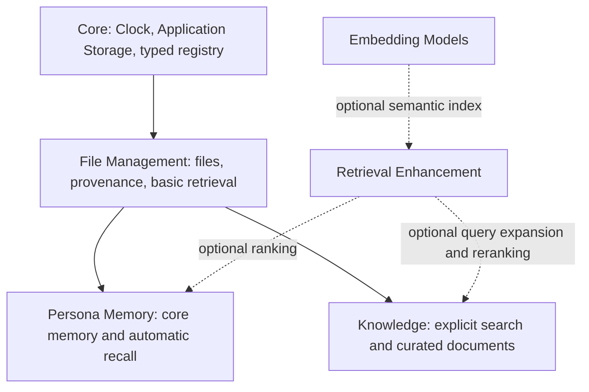

# Retrieval, model services and core settings

## Ownership



Memory requires Persona and File Management. It does not require Knowledge,
document parsing, embedding models or a reranker. Knowledge is searched explicitly;
this release does not add automatic knowledge injection to conversations.

Memory recall policies belong to a character: local or model-assisted query
construction, history window, query character budget, reasoning, prompt, result
limit, cutoff and optional semantic retrieval. `memory.query` is character-scoped.
Existing global policies and explicitly selected query routes migrate to existing
characters once. New characters default to local query construction. Character
packages carry portable recall policies, never local model bindings.

The local path uses `Intl.Segmenter`, preserves identifiers, dates and negation,
weights recent natural conversation, removes filler words and bounds the query.
System, tool, observation and previous recall messages are not topic material.
The model path receives only bounded current/recent text. It returns up to four
short queries; failure falls back to the local query. It never appends the whole
conversation to the search key.

Basic ranking uses BM25. The library's existing FTS5 index selects bounded
candidates; BM25 scores the permitted candidate records. This is not a complete
library BM25 score and is not a comparable cosine score. Hybrid ranking uses
reciprocal rank fusion. No vector reindex is required for this change.

Retrieval Enhancement offers query expansion and result reranking without an
encoder dependency. Semantic indexing still needs Embedding Models and a selected
shared encoder. The embedding fingerprint and stored indexes are unchanged.
Reranking is opt-in per explicit knowledge search; either a language model or a
dedicated reranker can rank a bounded set of candidates. Dedicated rerank adapters
must return valid, unique candidate indexes. An OpenAI-compatible service with a
Cohere-style `/rerank` endpoint is supported, including an existing local endpoint.
This does not automatically download or launch arbitrary reranker weights.

## Model services

`core.inference.kinds@1` uses the existing capability registry and lifecycle. Core
registers language/vision, Embedding Models registers embeddings, and Retrieval
Enhancement registers rerankers. The frontend renders the active contributions.
Saved model capability flags, not an adapter's possible capabilities, determine
which existing services appear in a model category. A MiniCPM-V generation model
does not appear among embeddings unless the user explicitly declares that model
as an embedding model. External worker account configuration remains in the owner
plugin's settings.

The unified credential input checks `credentials.status`, which returns only
availability and source. Blank input preserves a credential. Environment-backed
credentials display their source. No placeholder is submitted as a secret.

## Clock and storage

Clock and Application Storage are built-in components, visible in Extensions and
not disable-able. Clock defines the application time zone (`system` or an IANA
name). Existing task overrides are retained; new task defaults and model-facing
Observe timestamps use the application zone. Persisted timestamps remain UTC.

Application Storage owns the data root. A migration is explicitly previewed and
registered for the next full restart. The startup process obtains the source
instance lock before copying, rejects overlapping/nonempty/link destinations,
checks space, copies and hashes files, runs SQLite integrity checks, and updates
declared managed-path fields. Persona and message text is not rewritten. External
libraries, models outside the data root, application binaries and projects are
not moved. Credentials move within the same machine/user account.

The bootstrap root keeps `storage-location.json`, also respected when a launcher
sets `ECHO_DATA_DIR`. A failed copy leaves the original locator intact and marks
the partial destination; it is never overwritten by a retry. A failed application
start after migration restores the original location. The source is retained;
cleanup is a separate deliberate action. Directory links in the data tree require
manual relocation or registration as external roots before this migration can run.

Backup uses the core SQLite snapshot/integrity primitive. Backup exports still
exclude credentials, unlike a local whole-application data move.

## Plugin packages

`.echo-plugin` is a ZIP container, not a new executable format:

- `echo-plugin.json`: existing versioned manifest, dependencies and permissions.
- `echo-package.json`: format `echo-plugin-v1`, Node entry and SHA-256 file list.
- Explicitly listed built JavaScript, assets and license files.

Create a package with:

```sh
pnpm exec tsx scripts/package-plugin.ts ./my-plugin ./my-plugin.echo-plugin main.mjs LICENSE main.mjs view.html
```

The packer uses an explicit file allowlist, rejects credential/database files and
requires a license. Import checks manifest compatibility, paths, duplicate names,
links, expansion limits and hashes before extraction. Inspection and installation
do not execute plugin code; enabling uses the ordinary permission/lifecycle path.
Updates install into a new private version directory, apply after restart and
retain the prior manifest for `plugins.package.rollback`. Hash verification is
integrity checking, not publisher authentication. Packages run trusted local Node
code and do not constitute an OS sandbox. Development directory loading remains.

Plugin packages, character packages and application backups are distinct formats.

## 0.12.1 audit corrections

Plugins declare managed reference locations with `storagePaths` in their manifest:

```json
{"storagePaths":[{"table":"documents","collection":"my-plugin.assets","pointers":["/files/*/location"]}]}
```

Pointers are frozen when a relocation is scheduled, so disabled plugins do not
need to execute during offline migration. A local plugin may declare only its
own collections or its own `character-settings.<id>` collection. Core handles
model profiles, connections and installed extension paths. Free text is never
searched and replaced. Pending relocation can be cancelled in Application Storage.

Plugin updates are checked against both loaded and already staged manifests.
A package cannot stage a dependency cycle to appear only after restart. Previous
versions are accessible through the plugin's Roll Back action.

See [the 0.12 audit](RELEASE-AUDIT-0.12.md) for the original gaps and their checks.
