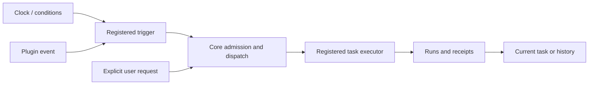

# Tasks and activity

Echo Agent keeps execution, task lifetime, and context retention separate.

The existing `core.automation.types@1` registry still owns task descriptors, configuration,
manual execution and disposal. `core.automation.signals@2` adds a `task` destination alongside
conversation and notice destinations. Version 1 signal providers remain supported. The
source owner must own the task type; cross-plugin actions require an explicitly authorized
operation. Clock-based Review and turn-count Review both enter the same dispatch path as
manual execution. Providers preserve their stable request IDs and durable execution receipts.
Domain-specific conditions stay with their owning plugin. There is no universal trigger
dropdown imposed on every task editor, and no new serial queue shared by all tasks.

## Task workspace

The character has one Tasks entry with Subtasks and Automation tabs. Active subtasks include outstanding one-off work and
ongoing tasks. Accepted one-off work, paused ongoing work and explicitly ended tasks are inactive; failures,
unknown outcomes and pending acceptance remain visible. Results, evidence and previous
attempts belong to the task details. Ongoing work can pause, resume or end independently of
the latest execution outcome. Worker sessions may continue between runs or start fresh;
retaining a conversation does not keep a process resident. Fresh runs retain prior attempts.

Autonomous delegation is a permission, separate from editable delegation guidance and
concurrency limits. Legacy `manual/auto/prefer` settings are interpreted without losing
written prompts. The role grants a ceiling for subtask models, directories, tools and
execution time; each task receives its own selected subset. Main-session permissions remain separate.
Pi file tools check canonical paths against the working directory and additional read/write
roots. Approved terminal execution runs as the OS user and is not an OS filesystem sandbox.
Codex supports additional writable roots; unsupported additional read-root constraints and
DSH multi-root requests fail explicitly instead of silently widening permissions.

## Review tasks

Multiple policies per character have independent cursors, source selections, model/executor,
instructions, reading checkpoints, and continuation notes. Existing policy counts are not
expanded during upgrade. Only genuine old global settings create a compatibility policy;
marking a conversation for Review alone does not silently create a task.

Continuation uses bounded task notes, with full previous jobs retained as records; it does
not replay every past packet into each new model request. No automatic post-Review compact
is introduced. Raw-observation retention considers the slowest configured consumer,
including paused policies. Newly created tasks can read retained archival sources.

Ordinary add/update/merge/archive/delete and core proposals are individual task grants.
Defaults retain the prior add-only permission. Mutation proposals can reference only full
memory records included in the frozen reading context, and must carry their current versions.
Writes are serialized, idempotent, scoped to the character, and retain before/after records.
Current grants are checked again before application. Core changes always go through the
optional Approvals contracts; rejection, stale versions or withdrawn grants never alter the
active core memory. Guidance remains editable; the enforcement protocol is program-owned.
The editor provides a read-only preview of assembled guidance.

Memory recall consumes `memory.queries@1` and `memory.retrieval@1`. The base memory plugin
provides local keyword extraction, model-assisted query construction, and keyword retrieval.
Semantic enhancement contributes semantic and hybrid choices without becoming a hard
dependency. Shared embedding indices remain application-owned. Pure semantic selection
fails explicitly if unavailable; the other choices can use the configured keyword fallback.

## Care

The user configures daily maximum, minimum interval, available hours, quiet time, and selected
registered blockers. Candidate opportunities are spread over the remaining window and stored;
missed or blocked opportunities are not accumulated for a later burst. Counts are upper bounds,
not promised messages. Same-conversation serialization and human-input priority remain core
constraints. Existing daily limits, timing and handwritten instructions survive migration.

## Avatar states

`avatar.states@1` is an optional extension point owned by Avatar. Providers register a label,
default priority, fallback, default clip, and scoped active instance leases. Multiple task
instances can hold the same state; finishing one does not clear another. Expired leases and
unloaded providers disappear from the active set. Snapshots are refreshed by events and active
lease deadlines, without idle polling or another resident worker.

Character configuration maps each registered state to a clip and optional priority override.
The native renderer resolves concurrent states deterministically. Frame animation shows one
primary clip, with short transition hysteresis. Visual priorities never modify scheduler priorities.

The importer accepts PetDex `pet.json` with `spritesheet.webp` or `.png`, in 8×9 or 8×11
proportional grids, as a directory, selected JSON, or ZIP. It normalizes rows into Echo clips
and retains the original metadata and atlas locally. It does not assume that a row named
`review` refers to memory Review, or assume that downloaded assets have a particular license.

References: [DeepSeek execution design](https://github.com/deepseek-ai/dsh-superagent-prototype/blob/main/docs/003-execution.md),
[PetDex package format](https://github.com/crafter-station/petdex#pet-package-format).
